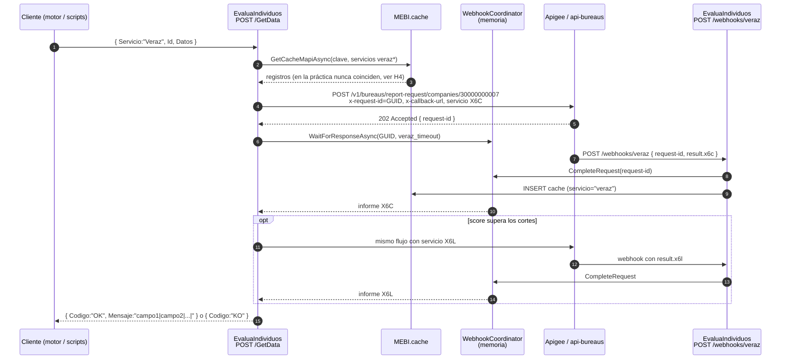

# Circuito api-bureaus (Veraz) en EvaluaIndividuos

Fecha del análisis: 2026-11-23 · Repo `motor-ind`, rama `main`, commit `f9f555b`

## 1. Resumen

EvaluaIndividuos consulta Veraz a través de **api-bureaus** (expuesta por Apigee) con un patrón **síncrono sobre asíncrono**. `POST /GetData` dispara un pedido que el bureau acepta con `202`, y el hilo queda esperando hasta que el informe llega por webhook a `POST /webhooks/veraz`.

Según el análisis estático, **el camino Veraz devuelve `KO` en casi todos los casos** por dos defectos que se combinan (H1 y H2, sección 6).

- **Alcance:** solo lectura de código. No se compiló ni se ejecutó nada, y no se revisaron logs ni datos de producción.
- **Fuera de alcance:** el circuito SIISA (comparte el endpoint `/GetData`) y las políticas de evaluación que consumen los campos `*_no_bureau`.
- **Cómo usar este documento:** cada hallazgo indica archivo y línea para verificarlo. Lo que no se puede resolver desde el código está en la sección 8, Preguntas abiertas.

## 2. Arquitectura

Puntos clave del diseño:

- **La espera se resuelve en memoria.** El vínculo entre el pedido y el webhook es un `TaskCompletionSource` indexado por `request-id` dentro de un singleton.
- **El callback siempre vuelve a la misma máquina.** La URL se arma con `Environment.MachineName` (`https://<MAQUINA>.macro.com.ar:50008/EvaluaIndividuos/Webhooks/Veraz`). Esto es necesario porque cada instancia tiene su propia memoria: si el webhook llega a otro nodo, se pierde.
- **Kestrel escucha en `http://localhost:50008`.** Se asume que adelante hay un IIS o reverse proxy que termina TLS y agrega el `PathBase` `/EvaluaIndividuos`.

## 3. Componentes y archivos

Rutas relativas a `EvaluaIndividuos/`.

| Componente | Archivo | Rol |
| --- | --- | --- |
| Registro de dependencias (DI) | `Program.cs` (l. 28-54, 86) | Registra `api_bureaus_v1_0_6_Client` con `ApigeeAuthHandler` y el header `x-callback-url`, y `WebhookCoordinator` como singleton |
| Endpoint de entrada | `Endpoints/GetData.cs` (`GetVeraz`, `GetInformeVeraz`, `MapeaVeraz`) | Parsea `Datos`, lee caché, pide X6C/X6L, espera y arma la salida |
| Endpoint webhook | `Endpoints/Webhooks.cs` | `POST /webhooks/veraz`: deserializa, despierta la espera y guarda en caché. `POST /webhooks/veraz_estricto`: solo guarda |
| Coordinador | `Model/WebhookCoordinator.cs` | `ConcurrentDictionary<requestId, TaskCompletionSource>` con timeout |
| Autenticación | `Model/ApigeeAuthHandler.cs`, `Model/TokenService.cs` | Token OAuth `client_credentials` cacheado en memoria; agrega `Bearer` y `apikey`; completa la URL base |
| Caché | `Database/MEBI/MEBIService.cs` (`GetCacheMapiAsync`), `Database/MEBI/Model/CacheMapi.cs` | Tabla `cache` de MEBI, clave (`fecha_hora`, `servicio`, `clave`) |
| Parámetros | `Model/ParametrosProvider.cs`, `Model/Parametros.cs` | `veraz_*`, `apigee_*` |
| Contrato del pedido | `Services/api-bureaus_v1.0.6 .yaml` (el nombre tiene un espacio) | `POST /v1/bureaus/report-request/companies/{company-taxpayer-number}` → 202 |
| Contrato del webhook | `Services/api-webhooks_v1.9.1.yaml`, esquema `webhooks-veraz-post-request` | `request-id`, `bureau`, `status-code`, `company-taxpayer-number`, `result.x6c` / `result.x6l` |
| Código generado | `obj/api-bureaus_v1.0.6 Client.cs`, `obj/api-webhooks_v1.9.1Client.cs` | NSwag lo genera en el build (no está versionado) |

## 4. Flujo paso a paso

1. **Entrada** (`GetData.cs` l. 32-58). Llega `POST /GetData` con `Servicio = "Veraz"`, `Id` (GUID) y `Datos`. Se registra la traza con `registro.Encadena` y se resuelve el cliente de api-bureaus.
2. **Parseo** (l. 69-80). `Datos` se separa por `|` en: CUIL, DNI, sexo, nombre, cortes `thin-thick` e `ignoraCache`. La clave es el CUIL; si no es numérico, se usa el DNI.
3. **Lectura de caché** (l. 81, 97). Se consulta `cache` con los servicios `veraz`, `verazX6`, `verazX6c` y `verazX6l`. Un registro vale si tiene menos de `veraz_vigencia_cache` días y `ignoraCache != "1"`.
4. **Pedido X6C** (`GetInformeVeraz`, l. 147-186).
   - Se arma `PostReportRequestRequest`: documento, tipo (`CUIL` si tiene 11 dígitos, si no `DNI`), nombre y género.
   - Bureau `Veraz` con servicio `X6C`.
   - `CachePolicy` (`ValidityDays`, `IsIgnored`) y `Billing` (código, centro de costos, `IdTransaction = Id`).
   - Se llama a `PostReportRequestAsync` con `x-request-id` = GUID nuevo, `x-channel = 1`, el callback propio y el CUIT de ruta fijo `30000000007`.
   - `ApigeeAuthHandler` agrega el token y la `apikey`. Respuesta esperada: **202**, sin datos del informe.
5. **Espera** (l. 189). `coordinator.WaitForResponseAsync(requestId, veraz_timeout)`, 10 segundos por defecto. Si vence, la tarea se cancela y la excepción cae en el `catch` general.
6. **Webhook** (`Webhooks.cs` l. 29-64). Deserializa con `System.Text.Json` en kebab-case, llama a `CompleteRequest(RequestId)` e inserta el JSON en `cache` con `servicio = "veraz"` y `clave = CompanyTaxpayerNumber`.
7. **Decisión del informe largo** (l. 113-115). Se pide X6L si `(ScorePopulation == "OK" && RiskScore > corteThick) || RiskScore > corteThin`. Para el pedido se repiten los pasos 4 a 6 con `X6L`.
8. **Salida** (`MapeaVeraz`, l. 192-243). Se arma un string de 44 campos separados por `|` y se devuelve `{ Codigo: "OK", Mensaje }`.
9. **Error.** Cualquier excepción (timeout, HTTP, nulos) devuelve `{ Codigo: "KO", Mensaje: "No se obtuvo informe" }`. Solo se loguea "Error con Veraz", sin el detalle de la excepción.

A diferencia de SIISA, el camino Veraz **no graba un dictamen** en MEBI. Lo único que persiste es el registro de caché que escribe el webhook.

## 5. Parámetros y contratos

### 5.1 Parámetros

| Parámetro | Default | Uso |
| --- | --- | --- |
| `veraz_vigencia_cache` | 30 | Días de validez de la caché local; también se envía como `CachePolicy.ValidityDays` |
| `veraz_timeout` | 10 | Segundos de espera del webhook, por informe |
| `veraz_codigo_de_facturacion` | `001` | `Billing.Code` |
| `veraz_centro_de_costos` | `002` | `Billing.CostCenterCode` |
| `apigee_base_url` | — | URL base de Apigee en producción. En ambiente bajo se fuerza `https://api-test.gcp.macro.com.ar` |
| `apigee_client_id` / `apigee_secret` | — | Cifrados; se descifran con `CryptoService` |

### 5.2 Entrada: campo `Datos`

`cuil|dni|sexo|nombre|corteThin-corteThick|ignoraCache`

Si faltan los cortes se usa `999-999`. Si falta `ignoraCache` se usa `0`.

### 5.3 Salida: campo `Mensaje` (44 posiciones)

| Pos. | Origen | Campos |
| --- | --- | --- |
| 1-4 | X6C | nombre, score, población, income predictor |
| 5-9 | X6L | categoría, CUIL, domicilio, tipo de cliente, versión DNI |
| 10-16 | X6L tarjetas | antigüedad, peor situación 12m, saldo fin./límite, peerbank, exigible, límite y pago mínimo máximos de la competencia |
| 17-20 | X6L cuentas corrientes | antigüedad, peor situación 12m, uso promedio/límite, saldo promedio |
| 21-24 | X6L préstamos | refinanciados, exigible sin garantía, prendario, hipotecario |
| 25-27 | X6L bureau / BCRA | peor situación actual, BCRA 12m, BCRA 3m |
| 28-38 | X6L situación legal | morosidad, juicios ejecutivos y ordinarios, pedidos de quiebra, concursos, quiebras decretadas, inhibiciones |
| 39-41 | X6L cheques | montos y cantidad de rechazados en 24m |
| 42-43 | Interno | `estado_transact` del corto y del largo |
| 44 | Fijo | `Respuesta OK` (seguido de un separador final) |

### 5.4 Códigos de `estado_transact`

| Código | Significado |
| --- | --- |
| `0` | Consultado online al bureau |
| `6` | Tomado de la caché local |
| `7` | No consultado (valor inicial; es el que queda para el largo cuando no se pide) |

### 5.5 Pedido a api-bureaus

`POST {apigee}/v1/bureaus/report-request/companies/30000000007`

- **Headers:** `x-request-id`, `x-channel: 1`, `x-callback-url`, `apikey`, `Authorization: Bearer`.
- **Respuesta esperada:** `202 { request-id }`.
- **Errores documentados:** 400, 401, 404, 409, 429 y 5xx.

## 6. Hallazgos

La severidad es una estimación a partir del código y se debe validar con logs de producción.

| ID | Severidad | Hallazgo | Ubicación |
| --- | --- | --- | --- |
| H1 | Crítica | Si no se pide el informe largo, la respuesta es siempre `KO` | `GetData.cs` l. 133, 195-201 |
| H2 | Crítica | La segunda llamada (X6L) arma una URL duplicada | `GetData.cs` l. 159-161 |
| H3 | Alta | La caché del largo se asigna a la variable del corto | `GetData.cs` l. 119 |
| H4 | Alta | La caché de Veraz se escribe pero nunca se lee | `GetData.cs` l. 81, 97, 119; `Webhooks.cs` l. 50-57 |
| H5 | Alta | Condición de carrera entre el 202 y el webhook | `GetData.cs` l. 186-189 |
| H6 | Alta | `company-taxpayer-number` es `int32` en el contrato del webhook | `api-webhooks_v1.9.1.yaml`; `Webhooks.cs` l. 51 |
| H7 | Alta | Seguridad: token en logs, webhook sin autenticación, secretos en el código | varios |
| H8 | Media | Los errores se tragan sin detalle | `GetData.cs` l. 138-144 |
| H9 | Baja | Menores | varios |

### H1 — Sin informe largo, la respuesta es siempre `KO`

- **Evidencia:** cuando no se pide X6L se ejecuta `informeLargo = new()` (l. 133), lo que deja `Result == null`. Después `MapeaVeraz` accede a `resultLargo.X6l.Evaluation...` sin control de nulos (l. 201 en adelante).
- **Efecto:** `NullReferenceException`, que el `catch` convierte en `KO` / "No se obtuvo informe". Con los cortes por defecto (`999-999`) nunca se pide el largo, así que siempre se llega a este caso.
- **Corrección sugerida:** mapear los campos de X6L de forma condicional (con `?.` y defaults) cuando el largo no exista.

### H2 — URL duplicada en la segunda llamada

- **Evidencia:** `GetInformeVeraz` hace `client.BaseUrl = <base> + client.BaseUrl` (l. 159 y 161). En un mismo `GetVeraz` se usa la misma instancia de `client` para X6C y para X6L.
- **Efecto:** en la segunda llamada `BaseUrl` queda `https://api-test...https://api-test.../v1/bureaus/`, una URL inválida, y la llamada X6L falla. Sumado a H1, el camino Veraz no tiene una ruta de éxito evidente.
- **Corrección sugerida:** quitar esas asignaciones. `ApigeeAuthHandler` ya completa las URLs relativas con la base correcta.

### H3 — La caché del largo se asigna al corto

- **Evidencia:** l. 119 deserializa `cacheLargo` en `informeCorto`.
- **Efecto:** si alguna vez hubiera un acierto de caché del largo, se pisaría el informe corto y además se volvería a llamar al servicio, porque `informeLargo` seguiría en `null`.
- **Corrección sugerida:** asignar a `informeLargo`.

### H4 — La caché de Veraz nunca se lee

- **Evidencia:**
  - El webhook guarda `Servicio = "veraz"` con `Clave = CompanyTaxpayerNumber`.
  - La lectura busca las claves de diccionario `clave + "verazX6C"` y `clave + "verazX6L"`, con la última letra en mayúscula. En cambio, el query filtra `verazX6c`/`verazX6l` y `ToDictionary` distingue mayúsculas de minúsculas.
- **Efecto:** nunca hay acierto de caché. Cada consulta va al bureau, con el costo de facturación que eso implica. La tabla `cache` solo acumula registros.
- **Corrección sugerida:** definir una convención única. Por ejemplo, el webhook guarda `verazX6C`/`verazX6L` según el servicio que trae el resultado, con clave = el documento consultado.

### H5 — Condición de carrera entre el 202 y el webhook

- **Evidencia:** la espera se registra en el coordinador **después** de que `PostReportRequestAsync` devuelve el 202 (l. 186-189).
- **Efecto:** si el bureau manda el webhook antes de ese registro, `CompleteRequest` no encuentra la entrada, el resultado se descarta y el pedido termina en timeout (`KO`). El riesgo crece cuando el bureau responde desde su propia caché.
- **Corrección sugerida:** registrar la espera antes del POST y cancelarla si el POST falla.

### H6 — El tipo de `company-taxpayer-number` no cierra

- **Evidencia:**
  - En `api-webhooks_v1.9.1.yaml` el campo es `integer/int32`, y el código generado lo declara `int?`.
  - Un CUIL o CUIT de 11 dígitos supera `int32` (máximo 2.147.483.647).
  - `long.TryParse(requestObj.CompanyTaxpayerNumber, ...)` en `Webhooks.cs` l. 51 no debería compilar contra un `int?`.
- **Efecto:** si el bureau envía el documento, la deserialización falla y el endpoint devuelve 400 sin completar la espera. Que no compile sugiere que el YAML o el código generado de producción difieren de lo versionado.
- **Corrección sugerida:** confirmar el contrato real con el equipo de api-webhooks y pasar el campo a `string` o `int64`.

### H7 — Seguridad

- El bearer token se loguea en texto plano (`ApigeeAuthHandler.cs` l. 22, `TokenService.cs` l. 75), igual que el client id.
- `/webhooks/veraz` no tiene autenticación ni validación de origen. Cualquiera que llegue al puerto puede insertar registros en `cache`. Para inyectar un resultado en un pedido en curso, alcanza con conocer su GUID.
- Hay credenciales de ambiente bajo cifradas y escritas fijas en el código (`GetData.cs` l. 158, `ApigeeAuthHandler.cs` l. 35, `TokenService.cs` l. 46-47). Su seguridad depende de la clave que use `CryptoService`.
- **Corrección sugerida:** sacar los tokens de los logs; validar el webhook (firma, mTLS o lista de IPs de Apigee); mover las credenciales a parámetros o a un vault.

### H8 — Errores sin detalle

- **Evidencia:** `catch (Exception)` loguea solo "Error con Veraz" (l. 138-144).
- **Efecto:** no se puede distinguir un timeout de un 4xx/5xx o de un nulo, lo que complica el diagnóstico de H1 a H6 en producción.
- **Corrección sugerida:** `Log.Error(ex, ...)` incluyendo `request-id`, el servicio (X6C/X6L) y el tipo de error.

### H9 — Menores

- La variable `apikey` en `GetInformeVeraz` se calcula y no se usa.
- El `CancellationTokenSource` de `WebhookCoordinator` nunca se libera. Además, si el webhook llega, el callback de timeout queda vivo hasta que vence.
- `/webhooks/veraz_estricto` graba con `Clave = 1` fija.
- `RiskScore` puede ser `null`. En ese caso las comparaciones de corte dan `false` y no se pide el largo, lo que lleva a H1.
- El header `x-callback-url` se agrega dos veces: en el `HttpClient` (`Program.cs` l. 52) y como parámetro de la operación.
- El nombre del archivo `api-bureaus_v1.0.6 .yaml` tiene un espacio.

## 7. Recomendaciones (orden sugerido)

1. Corregir H1 y H2. Son cambios chicos en `GetData.cs` y desbloquean el camino de éxito.
2. Corregir H5: registrar la espera antes del POST.
3. Confirmar el contrato del webhook (H6) y alinear el código generado con lo que corre en producción.
4. Definir la convención de caché y corregir H3 y H4. Esto reduce las llamadas facturables.
5. Mejorar el log de errores (H8) antes de desplegar, para poder medir el efecto de los cambios.
6. Aplicar los cambios de seguridad (H7).
7. Si se escala a más de un nodo, evaluar una persistencia compartida para la correlación, por ejemplo poll a la tabla `cache` o Redis, en lugar de la memoria del proceso.

## 8. Preguntas abiertas para la revisión

- ¿Qué devuelve hoy producción para `Servicio = "Veraz"`? ¿Qué proporción de `KO` hay? Esto confirmaría o descartaría H1 y H2.
- ¿Qué cortes `thin-thick` envían los consumidores en `Datos`?
- ¿Qué valor manda el bureau en `company-taxpayer-number`: el documento de la persona, el CUIT fijo `30000000007` o `null`?
- ¿El CUIT fijo `30000000007` en la ruta es intencional, como el CUIT del banco solicitante?
- ¿Cuántos nodos atienden EvaluaIndividuos? ¿El callback siempre resuelve al mismo host?
- ¿Se necesita persistir un dictamen de Veraz, como se hace con SIISA?
- ¿Qué versión del YAML de api-webhooks se usó para compilar lo que está desplegado?
